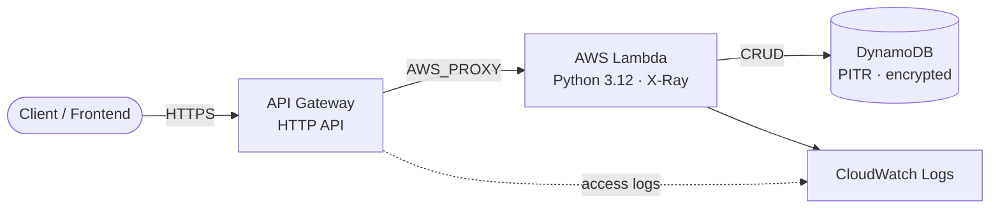

# AWS Serverless REST API (Terraform)

> Production-grade, modular serverless CRUD API on AWS — API Gateway + Lambda + DynamoDB — with CI security scanning and dev/prod environments.
> **Author:** Muhammad Ahmad · **IaC:** Terraform (modular) · **Cloud:** AWS


---

## 🏗️ Architecture

> 🎨 **Interactive diagram (industry-standard icons):** [open in Lucid — page 2](https://lucid.app/lucidchart/3da75ce3-ea66-4296-81b3-00d20a60435b/edit)



## 📦 Module layout

```
terraform/
├── backend.tf            # remote state (bootstrap notes)
├── main.tf               # packages Lambda + calls the api module
├── variables.tf          # typed, validated inputs
├── environments/{dev,prod}.tfvars
└── modules/api/          # DynamoDB, Lambda, IAM, API Gateway, logging
```

## ✨ Production features

- **DynamoDB** — point-in-time recovery, server-side encryption, prod deletion protection.
- **Lambda** — **X-Ray** active tracing, least-privilege IAM (table + logs + xray only).
- **API Gateway** — **access logging** to CloudWatch and **throttling** (burst 100 / rate 50).
- **CI** — GitHub Actions runs `fmt`, `validate`, **TFLint**, **tfsec**, **Checkov** on every PR.

## 🔌 API routes

| Method | Path | Action |
|--------|------|--------|
| `GET` | `/items` | List items |
| `POST` | `/items` | Create an item |
| `GET` | `/items/{id}` | Get one item |
| `DELETE` | `/items/{id}` | Delete an item |

## 🚀 Deploy

```bash
cd terraform
terraform init
terraform apply -var-file=environments/dev.tfvars   # or prod.tfvars
```

## 🧹 Clean up

```bash
terraform destroy -var-file=environments/dev.tfvars
```

## 💰 Cost note

DynamoDB on-demand + Lambda + API Gateway are pay-per-use — idle cost ≈ **$0**.

---

*Built and maintained by **Muhammad Ahmad**.*
