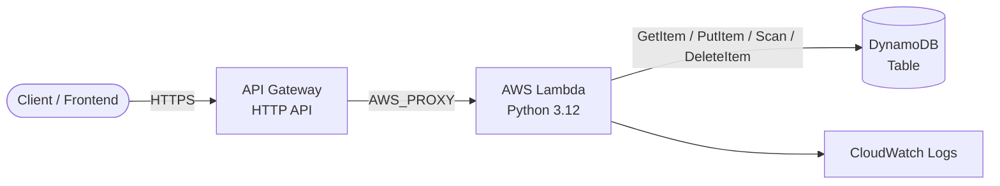

# AWS Serverless REST API (Terraform)

> Fully serverless CRUD REST API on AWS — API Gateway + Lambda + DynamoDB — provisioned with Terraform.
> **Author:** Muhammad Ahmad · **IaC:** Terraform · **Cloud:** AWS


---

## 📌 Overview

A **pay-per-request, no-servers-to-manage** REST API:

- **API Gateway (HTTP API)** exposes the public HTTPS endpoint and routes requests.
- **AWS Lambda** (Python 3.12) runs the business logic — a small CRUD handler.
- **DynamoDB** stores the items in a fully managed, on-demand table.
- **CloudWatch Logs** captures function logs with a 14-day retention.
- **IAM** gives Lambda least-privilege access to just its table and logs.

## 🏗️ Architecture



## 🔌 API routes

| Method | Path | Action |
|--------|------|--------|
| `GET` | `/items` | List items (up to 100) |
| `POST` | `/items` | Create an item (`{"name": "..."}`) |
| `GET` | `/items/{id}` | Get one item |
| `DELETE` | `/items/{id}` | Delete an item |

## 🚀 Deploy

**Prerequisites:** Terraform ≥ 1.5, AWS credentials configured.

```bash
cd terraform
terraform init
terraform apply
```

Test it once deployed:

```bash
API=$(terraform output -raw items_endpoint)

# Create
curl -s -X POST "$API" -d '{"name":"first item"}'

# List
curl -s "$API"
```

## 🧹 Clean up

```bash
terraform destroy
```

## 💰 Cost note

DynamoDB is **on-demand** and Lambda / API Gateway are pay-per-use, so idle cost is effectively **$0** — ideal for demos and low-traffic APIs.

## 🔐 Production hardening (next steps)

- Add **JWT / Cognito** authorizer on the API routes.
- Add request validation and structured logging.
- Add a **custom domain** + ACM certificate.
- Add DynamoDB **point-in-time recovery**.

---

*Built and maintained by **Muhammad Ahmad**.*
