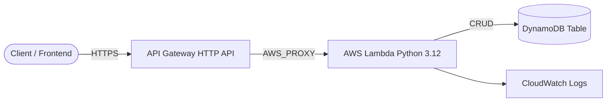

# Architecture Diagram — AWS Serverless REST API

## Lucid diagram

- **Master Lucid document (all 30 diagrams, icon style):** https://lucid.app/lucidchart/3da75ce3-ea66-4296-81b3-00d20a60435b/edit
- This project is **page 2** of that document.

## Lucid prompt (reusable)

```
Create an AWS serverless architecture diagram titled "AWS Serverless REST API".
Left to right: a Client connects over HTTPS to API Gateway (HTTP API); API Gateway
proxies to an AWS Lambda function (Python); Lambda reads/writes a DynamoDB table and
writes to CloudWatch Logs. Label the arrows (HTTPS, AWS_PROXY, GetItem/PutItem).
Clean, professional AWS-style colors.
```

## Mermaid source


